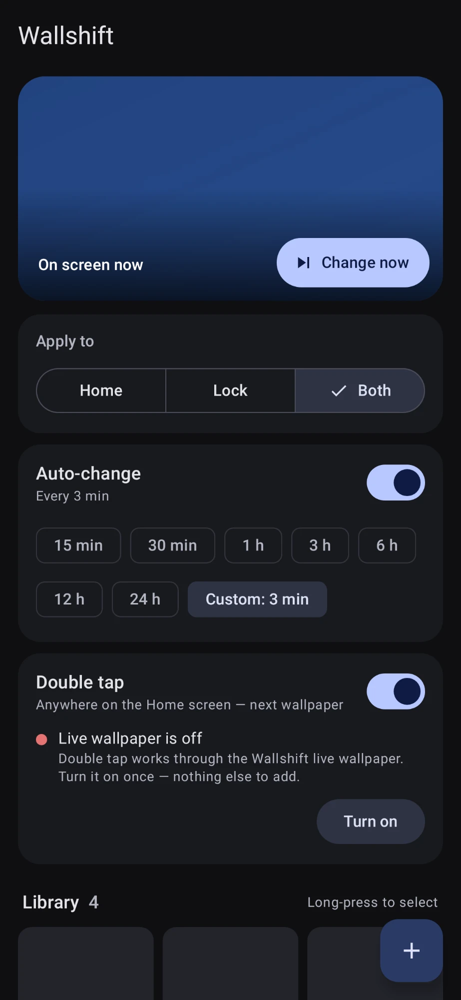

# Wallshift

A minimal, ad-free Android wallpaper changer. **Double-tap anywhere on the home screen for the next wallpaper**, or let it change automatically on a schedule. Kotlin + Jetpack Compose (Material 3), one Activity, one screen, always dark. No network, accounts, ads, analytics or notifications.

> Personal project, built with AI coding assistants (Claude Code) under my direction: I set the requirements, reviewed the code and tested every build on my own Xiaomi phone (HyperOS). It replaced the earlier Java / OpenGL ES app [wallpaper-shuffle](https://github.com/Senpay-7/wallpaper-shuffle).



**Download:** [`dist/Wallshift-1.0-release.apk`](dist/Wallshift-1.0-release.apk), about 1.5 MB, Android 8.0+ (minSdk 26).

## Features
- **Instant double tap:** the live wallpaper pre-decodes the next image from a queue the app publishes and shows it immediately with a 180 ms crossfade. The app confirms the change afterwards, so the "no repeats" rules still hold.
- **Fair shuffle bag:** with N images, N changes show every image exactly once, nothing repeats at the boundary between rounds, and images can be added or deleted mid-round.
- **Scheduling:** intervals of 15 minutes or more use a WorkManager `PeriodicWorkRequest`, which survives reboots. Shorter intervals, down to seconds, use a chain of *non-wakeup* exact alarms: nothing runs while the screen is off, and an overdue change fires when it turns on. The chain is re-armed after a reboot or an app update.
- **Lock screen:** the lock screen always shows the latest photo and never changes while the phone is locked; a pending change is applied right after unlock.
- **Apply to** the home screen, the lock screen or both; import through the system Photo Picker.

## Performance and battery
- **Separate `:wallpaper` process:** the live wallpaper runs on its own, holding just one bitmap and the drawing code, with no Compose, DataStore or coroutines. The launcher never waits for the main app.
- **Off the main thread:** images are decoded on a background thread straight into hardware (GPU) bitmaps. Nothing is redrawn when the home screen reappears.
- **Cheap inter-process messages:** the processes talk through small state files watched with **inotify** (no polling) plus a few explicit broadcasts.
- **Stable theme colours:** the wallpaper colours reported to the system stay stable, so Android / HyperOS does not recompute the theme and restart apps on every change.
- **Fast cold start:** empty `Application.onCreate`, lazy dependencies, on-demand WorkManager initialisation, R8 with resource shrinking, and a **Baseline Profile**.

## Quality and privacy
- **66 unit and Robolectric tests** (`./gradlew test`).
- No `INTERNET` permission. The Photo Picker replaces storage permissions, and the foreground service is stripped from the manifest.

## Architecture
| Part | File |
|---|---|
| Shuffle bag (no repeats, round boundaries, mid-round insert/delete) | `domain/ShuffleBag.kt` |
| Library index (JSON in `filesDir`, StateFlow) | `data/WallpaperStore.kt` |
| Import: screen-sized JPEG copy plus 300 px WebP thumbnail, 2 threads | `data/Importer.kt` |
| Setting the wallpaper (`setBitmap` with screen flags) | `data/WallpaperChanger.kt` |
| Settings and queue state | `data/SettingsRepository.kt` (DataStore) |
| Auto-change: WorkManager (≥ 15 min) and AlarmManager (< 15 min) | `work/AutoChange.kt` |
| Live wallpaper: drawing, crossfade, double tap | `wallpaper/WallshiftWallpaperService.kt`, `wallpaper/DoubleTapDetector.kt` |
| Instant-switch queue (preload, confirmations) | `wallpaper/EngineQueue.kt` |
| Shared state between processes (files + inotify) | `shared/SharedState.kt`, `tap/EngineEventsReceiver.kt` |
| UI and state | `ui/MainScreen.kt`, `ui/MainViewModel.kt` |

## Build
Requires JDK 17+ and Android SDK platform / build-tools 37.
```bash
./gradlew test             # 66 unit + Robolectric tests
./gradlew assembleRelease  # app/build/outputs/apk/release/app-release.apk
```
The signing keystore is **not** included in this public repository. Put your own at `keystore/test-release.jks` or change `signingConfigs` in `app/build.gradle.kts`.

Stack: AGP 9.5, Gradle 9.9, Kotlin 2.4, Compose BOM 2026.09, WorkManager 2.12, DataStore 1.3, Coil 3.

Detailed notes in Russian: [README.ru.md](README.ru.md).
